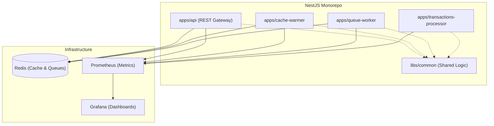

# MultiversX Assets CDN - API

Unified REST API facade and background synchronization service for serving, proxying, and caching blockchain token, identity, and account metadata in the MultiversX ecosystem.

---

## 🚀 Quick start

1.  **Install Dependencies:**
    ```bash
    npm install
    ```
2.  **Environment Setup:**
    Copy the example environment file and configure your credentials:
    ```bash
    cp .env.example .env
    # Edit .env and configure your variables
    ```
    Minimum required values:

    | Variable | Purpose |
    | :------- | :------ |
    | `GITHUB_TOKEN` | Token used to pull asset repositories (use a fine-grained, read-only token) |
    | `REPO_OWNER` / `REPO_NAME` / `BRANCH` | Source repository synced by the cache warmer |
    | `REDIS_HOST` / `REDIS_PORT` / `REDIS_PASSWORD` | Cache, queue and rate-limit storage |
    | `ALLOWED_HOSTS` | Comma-separated host allowlist used to build absolute icon URLs |
3.  **Build the Monorepo:**
    The start scripts execute the compiled output in `dist/`, so build once before starting:
    ```bash
    npm run build:all
    ```
4.  **Start Services:**
    Start the required infrastructure (Redis, Prometheus, Grafana):
    ```bash
    docker compose up -d
    ```

After running the services, you can shut down the containers using:

```bash
docker compose down
```

---

## 📦 Dependencies

1.  **Redis Server:** Required for high-performance distributed caching, rate-limiting, and queue management (via Bull).
2.  **Prometheus & Grafana:** Included for built-in observability, metrics collection, and monitoring dashboards.

---

## 🏃 Running the Apps

This is a NestJS monorepo containing multiple operational microservices. You can start any of them using the predefined npm scripts.

### 1. API Gateway (`apps/api`)

Provides high-performance public REST endpoints and serves the core application API.

- **Start Command:**
  ```bash
  npm run start:api
  ```
- _Default Port:_ [http://localhost:3004/assets-cdn](http://localhost:3004/assets-cdn) (Private Port: 4004)

### 2. Cache Warmer (`apps/cache-warmer`)

Runs periodic background jobs to keep the Redis cache populated with fresh data.

- **Start Command:**
  ```bash
  npm run start:cache-warmer
  ```
- _Default Port:_ 4100

### 3. Queue Worker (`apps/queue-worker`)

Handles asynchronous task processing using Bull queues.

- **Start Command:**
  ```bash
  npm run start:queue-worker
  ```
- _Default Port:_ 4002

### 4. Transactions Processor (`apps/transactions-processor`)

Dedicated microservice for indexing and processing blockchain transactions.

- **Start Command:**
  ```bash
  npm run start:transactions-processor
  ```
- _Default Port:_ 4003

---

## 🌐 API Endpoints

Public endpoints are served on port `3004`, health/readiness on the public app, and metrics on the private port `4004`.

| Method | Path                                            | Description                                          |
| :----- | :---------------------------------------------- | :--------------------------------------------------- |
| `GET`  | `/health` · `/ready`                            | Liveness and readiness probes                        |
| `GET`  | `/assets-cdn/:network/accounts`                 | Full account collection                              |
| `GET`  | `/assets-cdn/:network/accounts/:address`        | Single account metadata                              |
| `GET`  | `/assets-cdn/:network/accounts/:address/icon.png` · `icon.svg` | Account avatar                          |
| `GET`  | `/assets-cdn/:network/identities`               | Full identity collection                             |
| `GET`  | `/assets-cdn/:network/identities/:identity`     | Single identity metadata                             |
| `GET`  | `/assets-cdn/:network/identities/:identity/icon.png` | Identity avatar                                 |
| `GET`  | `/assets-cdn/:network/tokens`                   | Full token collection                                |
| `GET`  | `/assets-cdn/:network/tokens/:identifier`       | Single token metadata                                |
| `GET`  | `/assets-cdn/:network/tokens/:identifier/icon.png` · `icon.svg` | Token logo                     |

`:network` accepts `devnet`, `testnet` or `mainnet`. Item identifiers passed to the collection route (for example `/assets-cdn/tokens/WEGLD-bd4d79`) are automatically delegated to the item handler, matching the behaviour of `tools.multiversx.com/assets-cdn`.

Responses are served with `Cache-Control` headers (300s for collections, 1h for icons) and SVG icons additionally ship a restrictive `Content-Security-Policy` and `X-Content-Type-Options: nosniff`.

---

## 🧪 Testing

We ensure service reliability and performance via comprehensive test suites:

### Unit Tests

Executes Jest unit tests across all applications and shared libraries:

```bash
npm run test
# Watch mode
npm run test:watch
# Coverage report
npm run test:cov
```

### End-to-End (E2E) Tests

Runs integration tests against the API gateway:

```bash
npm run test:e2e
```

### Load Tests (k6)

> [!NOTE]
> Ensure the API Gateway service is actively running before starting the load tests.

Performs automated performance and load testing against the HTTP endpoints:

```bash
npm run test:performance
```

### Adversarial & Load Suite

A two-phase harness that first fires ~30 hostile requests (invalid networks, path traversal, null bytes, SQLi/XSS payloads, prototype-pollution identifiers, unsupported extensions, wrong HTTP methods) and asserts each is rejected, then benchmarks cached icons and collection JSON with `autocannon` across concurrency 1 → 100, reporting RPS and p50/p90/p99 latency:

```bash
node test/performance/adversarial-performance-suite.js
# Or point it at another instance
BASE_URL=http://localhost:3004 node test/performance/adversarial-performance-suite.js
```

> [!NOTE]
> The load phase shells out to `npx autocannon` and writes its report to `test/performance/load-results.json` (git-ignored).

---

## 🏗️ Architecture & Microservice Modes

This project is structured as a robust NestJS Monorepo to separate public web-serving concerns from periodic background workloads and intensive transaction processing.



### Shared Libraries (`libs/common`)

Contains reusable entities, DTOs, configuration schemas, and decorators shared across all microservices to enforce consistency.

---

## 📊 Observability & Monitoring

The monorepo comes pre-configured with a full observability stack using Prometheus and Grafana.

- **Prometheus:** Scrapes metrics from the private ports of all microservices.
  - _Dashboard:_ [http://localhost:9090](http://localhost:9090)
- **Grafana:** Provides rich visualizations and dashboards for the collected metrics.

  You can find a predefined Grafana dashboard with basic metrics at [http://localhost:3010](http://localhost:3010)

  Use `admin` for user and password fields. Then navigate to `Dashboards` -> `Template Service`

To view the monitoring data, ensure you have started the infrastructure containers via `docker compose up -d`.

---

## 🔧 Configuration Reference

Behavior is managed using environment variables loaded from the `.env` file and structured config via `config/config.yaml` & `config/schema.yaml`.

| Variable                  | Description                                                | Default               |
| :------------------------ | :--------------------------------------------------------- | :-------------------- |
| `PORT`                    | Listening port for the API REST Gateway service            | `3004`                |
| `privatePort` (config.yaml) | Private port for metrics/health                          | `4004`                |
| `ALLOWED_ORIGIN`          | Allowed domains for CORS (comma-separated, `*` allows all) | `*`                   |
| `ALLOWED_HOSTS`           | Allowed host headers for security enforcement              | `localhost,127.0.0.1` |
| `REDIS_HOST`              | Redis connection host                                      | `127.0.0.1`           |
| `REDIS_PORT`              | Redis connection port                                      | `6379`                |
| `REDIS_PASSWORD`          | Optional Redis password                                    | `""`                  |
| `PRIVATE_API_ALLOWED_IPS` | IP restrictions for private ports (metrics/health)         | `""`                  |
| `GITHUB_TOKEN`            | Read-only token used to sync the asset repository          | `""`                  |
| `REPO_OWNER`              | GitHub owner of the asset repository                       | `""`                  |
| `REPO_NAME`               | GitHub repository containing the assets                    | `""`                  |
| `BRANCH`                  | Branch synced by the cache warmer                          | `""`                  |
| `CDN_BASE_URL`            | Overrides the base URL used when resolving icon links      | `""` (derived)        |
| `GITHUB_SYNC_CONCURRENCY` | Parallel GitHub API requests during a sync                 | `""` (internal default) |
| `WARMER_CRON_SCHEDULE`    | Cron expression for metadata synchronization               | `0 */15 * * * *` (every 15 min) |
| `RATE_LIMIT_USE_REDIS`    | Store rate-limit counters in Redis instead of memory       | `false`               |

> [!IMPORTANT]
> `.env` (and any `.env.*`) are git-ignored and excluded from Docker images via `.dockerignore` — never commit real credentials. Only `.env.example` is tracked.

---

## 🛡️ Code Quality & Security

- **Linting & Formatting:** Enforced via ESLint and Prettier (`npm run lint`, `npm run format`).
- **Security Auditing:** Integrated `npm audit` check for production dependencies (`npm run audit:security`).
- **Host allowlisting:** Absolute icon URLs are only built from hosts present in `ALLOWED_HOSTS`; unknown `Host` headers fall back to the first allowed host (or are pattern-sanitized when no allowlist is configured).
- **Input validation:** Identifiers, identities and addresses are validated by regex and reject reserved names (`__proto__`, `constructor`, …) to prevent prototype pollution.
- **Rate limiting:** The public gateway applies 3000 requests / 15 min per IP (`/health` and `/ready` are exempt). Set `RATE_LIMIT_USE_REDIS=true` for a shared counter store across instances.
- **Response hardening:** `X-Powered-By` is disabled; SVG responses are served with `default-src 'none'` CSP and `X-Content-Type-Options: nosniff`.
- **Retries:** GitHub fetches retry with exponential backoff and honour `Retry-After` on `429`.

---

## 🚢 Deployment

Production deployment is documented in [`deploy/cdn/CLOUDFLARE_EDGE_RULES.md`](deploy/cdn/CLOUDFLARE_EDGE_RULES.md), covering the two mandatory infrastructure requirements:

1. **Edge CDN layer** (Cloudflare) in front of port `3004` to cache collections and icons.
2. **Dual-port ingress isolation** — public traffic bound only to `3004`, with `4004` (metrics) kept internal.

Docker builds use `.dockerignore`, which strips secrets, `.git` history, `node_modules`, tests and local logs from the image context.
